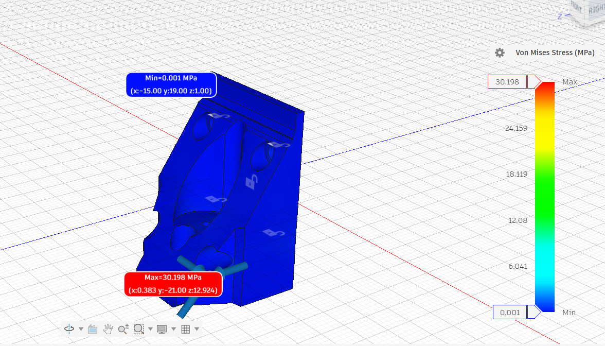

# EML4327-Shape-Optimization
Print head bracket optimization using Autodesk Fusion
# Shape Optimization & FEA Validation of a 3D Printer Print Head Bracket

**Course:** Digital Manufacturing (EML 4327)  

**Software:** Autodesk Fusion (Simulation & Design), UltiMaker Cura  

---

## Project Overview
This project focuses on lightweighting and validating a Fused Filament Fabrication (FFF) 3D printer print head mounting bracket. Using **Autodesk Fusion**, a topology (shape) optimization study was conducted on an ABS plastic baseline bracket to maximize stiffness while preserving critical mounting plates and bolt-hole interfaces across a YZ symmetry plane. The organic load-path result was reconstructed into a clean, parametric CAD model, validated through Static Stress finite element analysis (FEA) across multiple mesh densities, and sliced in **UltiMaker Cura** for additive manufacturing.

---

## Repository Contents

| File | Description |
| :--- | :--- |
| [`Term Project.pdf`](./Term%20Project.pdf) | Full engineering report with simulation setups, legends, and discussion |
| [`Bracket_original.f3d`](./Bracket_original.f3d) | Original baseline Autodesk Fusion CAD model and simulation setup |
| [`Bracket_opt.stl`](./Bracket_opt.stl) | Exported STL mesh of the redesigned, optimized bracket ready for slicing |
| [`Shape optimization.png`](./Shape%20optimization.png) | Load Path Criticality result from the Shape Optimization study |
| [`Optimized bracket.png`](./Optimized%20bracket.png) | Reconstructed, simplified parametric solid bracket |
| [`Von_mises_Bracket.png`](./Von_mises_Bracket.png) | Static Stress Von Mises distribution on the redesigned bracket |

---

## Design & Simulation Workflow

### 1. Shape Optimization
* **Material:** ABS Plastic
* **Objective:** Maximize stiffness with symmetry enforced across the **YZ plane**
* **Preserved Regions:** Motion stage facing plate (`2 mm`), print head facing plate (`1 mm`), and all mounting hole collars (`3 mm` thickness and radius)
* **Boundary Conditions:** Motion stage holes fixed in X and Y; motion stage facing surface fixed in Z
* **Load Cases:**
  * **Load Case 1:** `50 N` normal to print head surface + `15 N` in `+X` and `+Z`
  * **Load Case 2:** `50 N` normal to print head surface + `15 N` in `-X` and `-Z`

---

### 2. Parametric CAD Redesign & Static Stress Validation
The optimized load-path mesh was promoted to the Design workspace and used as a visual guide to extrude-cut excess material on one side before mirroring across the YZ symmetry plane.

#### **Key FEA Findings**
* **Vertical (Y) Displacement:** `0.013 mm` (Load Case 1) and `0.016 mm` (Load Case 2)—less than 15% of a standard `0.10–0.20 mm` print layer, ensuring minimal impact on print head positioning accuracy.
* **Von Mises Stress & Safety Factor:** Peak stresses reached `30.198 MPa` (Min FoS = `0.662`) in Load Case 1 and `54.585 MPa` (Min FoS = `0.367`) in Load Case 2, exceeding ABS yield strength (`~20 MPa`) and indicating a need for stiffer composite materials under full operational loads.

#### **Mesh Convergence Study (`10%`, `5%`, `3%`, `1%`)**

| Mesh Size (%) | Load Case 1 Max Stress (MPa) | Load Case 1 Max Disp. (mm) | Load Case 2 Max Stress (MPa) | Load Case 2 Max Disp. (mm) |
| :---: | :---: | :---: | :---: | :---: |
| **10%** | 31.860 | 0.014 | 58.967 | 0.016 |
| **5%** | 31.860 | 0.014 | 58.967 | 0.016 |
| **3%** | 42.440 | 0.014 | 76.152 | 0.019 |
| **1%** | 124.532 | 0.023 | 219.679 | 0.028 |

---

## Additive Manufacturing Preparation (UltiMaker Cura)
* **Build Orientation:** Placed flat on its side profile (YZ plane parallel to build plate) so continuous XY filament paths align with the L-shaped bending load path, avoiding weak Z-axis interlayer delamination.
* **Slicing Settings:** `0.20 mm` layer height, `4` perimeter walls (`1.6 mm`), `50%` Gyroid infill, `245 °C` nozzle temperature, and `105 °C` heated bed.
* **Material Recommendation:** Upgrading from unreinforced ABS to **Carbon Fiber-Reinforced Nylon (CF-Nylon)**, **Carbon Fiber ABS**, or **Polycarbonate (PC)** increases yield strength (`>60 MPa`) and stiffness while minimizing print head mass and thermal warping.

---

## Full Report
For complete figure legends, detailed analysis, and references, view the full document in [`Term Project.pdf`](./Term%20Project.pdf).
